# Maryland Unemployment Insurance: Are Claimants Paid Within 21 Days?

### 🔴 Live app: **[maryland-ui-pulse.vercel.app](https://maryland-ui-pulse.vercel.app)**

[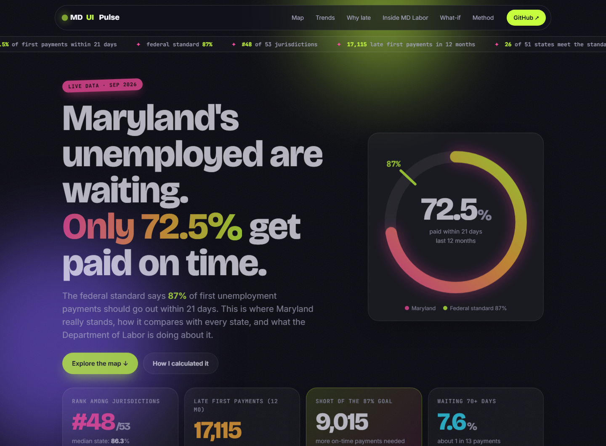](https://maryland-ui-pulse.vercel.app)

An end-to-end analytics project on how quickly Maryland pays first unemployment insurance (UI) benefits, built from public US Department of Labor data. It has three interactive dashboards: a performance overview, an analytics deep dive (peer benchmark, seasonality, claims forecast, what-if), and a page on what the Maryland Department of Labor is doing about its challenges.

The federal timeliness standard is that **87% of first payments should go out within 21 days** of the first compensable week.

## Key findings

| Metric | Value |
|---|---|
| Maryland, last 12 months, paid within 21 days | **72.5%** (standard: 87%) |
| Latest month (Sep 2026) | 67.8% |
| Rank among 53 jurisdictions (50 states, DC, PR, VI) | **48th**; median is 86.3% |
| Gap to the national pool (rolling 12 months) | about 12 points |
| Late first payments, last 12 months | about 17,100 of 62,300 |
| On-time payments needed to reach 87% | about 9,000 more per year |
| Payments taking more than 70 days | about 1 in 13 (7.6%) |
| Pace over the last few years | about +4 points a year; reaches 87% around **2030** at that rate |

Other findings:
- **Not a volume problem.** Since 2023, late payments average about 1,600 a month whatever the claim volume (correlation 0.01). That points to process bottlenecks such as issue resolution and identity verification, not intake capacity.
- **Persistent gap.** Maryland has been below the national pool in every month since January 2021. Annual rate: 89.9% in 2018, 47.4% in 2022, 69.3% in 2025 (US average 83.4%).
- **Surges are predictable.** A seasonal model forecasts weekly initial claims with a 5.7% average error on a 13-week backtest.
- **Fraud pressure.** New suspected ID-fraud claims were under 1% of claims before 2020, peaked at 35% in Q1 2023 and were 18% in Q4 2025 (department figures). Quarterly on-time rates tend to be higher when that share is lower (correlation -0.32 over 13 quarters, so only suggestive).

## Live web app

**[maryland-ui-pulse.vercel.app](https://maryland-ui-pulse.vercel.app)** is the interactive version of this whole project, deployed on Vercel (source in [`website/`](website/), no build step):

- an animated gauge and headline stats;
- an **interactive US map** with three lenses (on-time rate, change since 2019, rank), hover tooltips, click-to-compare with Maryland, a state picker and a Mid-Atlantic zoom;
- a **trend explorer** where you can overlay any state or the US pool on Maryland's rolling on-time rate;
- the delay distribution, a claims-vs-late-payments scatter and a 13-week claims forecast;
- **Inside MD Labor**: challenges and the department's responses, the overpayment timeline and department-reported figures;
- a **what-if slider** (drag a target on-time rate, see the extra people paid on time) and a methods section.

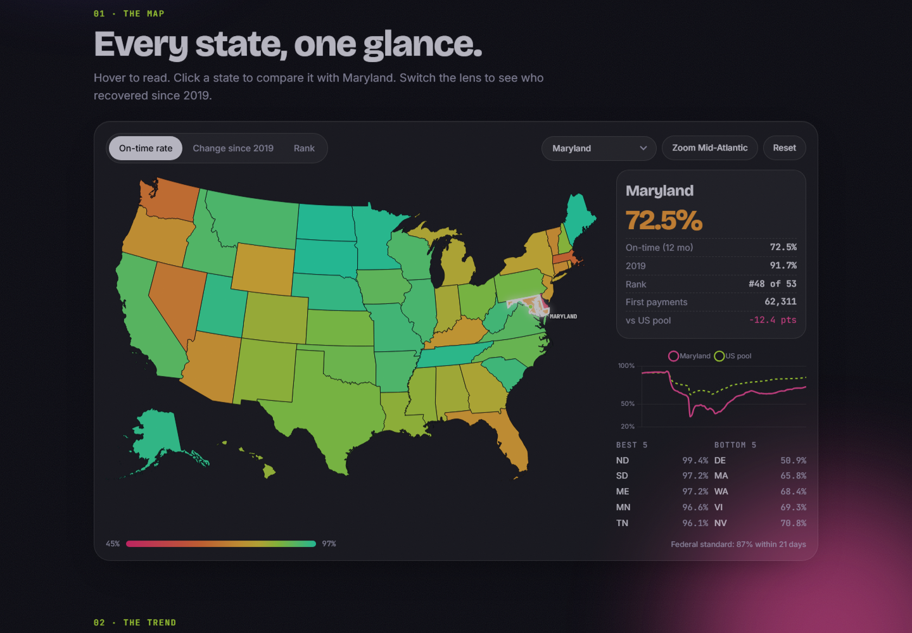

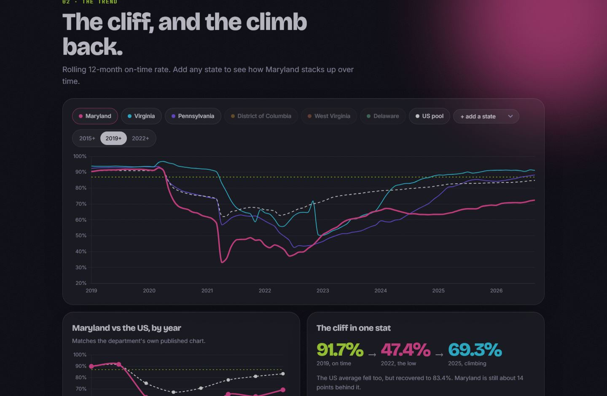

To rebuild its data: `python website/build_site_data.py` (after the `md-ui-project` scripts). To deploy: `cd website && vercel deploy --prod`.

## Dashboards

Open the HTML files in `md-ui-project/` directly in a browser. They are self-contained and work offline.

### 1. Executive overview: [`dashboard.html`](md-ui-project/dashboard.html)
KPIs, the 21-day trend against the 87% standard, a 53-jurisdiction ranking, the delay distribution and weekly claims demand.

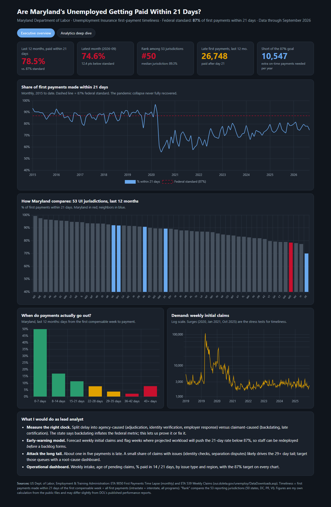

### 2. Analytics deep dive: [`analytics_dashboard.html`](md-ui-project/analytics_dashboard.html)
Peer trends, a seasonality heatmap, claims versus timeliness, a 13-week claims forecast, caseload trends and a what-if slider.

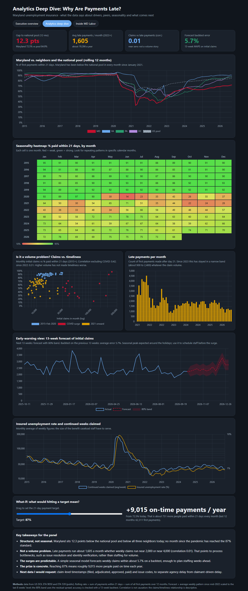

### 3. Inside MD Labor: [`department.html`](md-ui-project/department.html)
Interactive page built from the Maryland Department of Labor's February 2026 briefing to the House Government, Labor and Elections Committee, with five tabs:
- **Who they are:** the mission and eight divisions (click a division for details).
- **UI at a glance:** benefit levels, employer funding, claims per quarter and the annual on-time trend.
- **Challenges and responses:** ID fraud, funding, customer support and technology, each with the department's stated response and an "analyst angle" on how data could help.
- **Overpayment recovery:** a clickable timeline from the 2020 pause to the December 2025 retroactive process.
- **Wage enforcement:** wages recovered and Workplace Fraud Act enforcement.

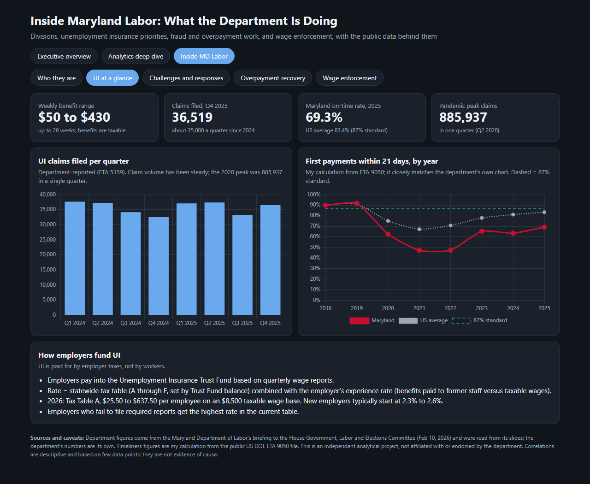

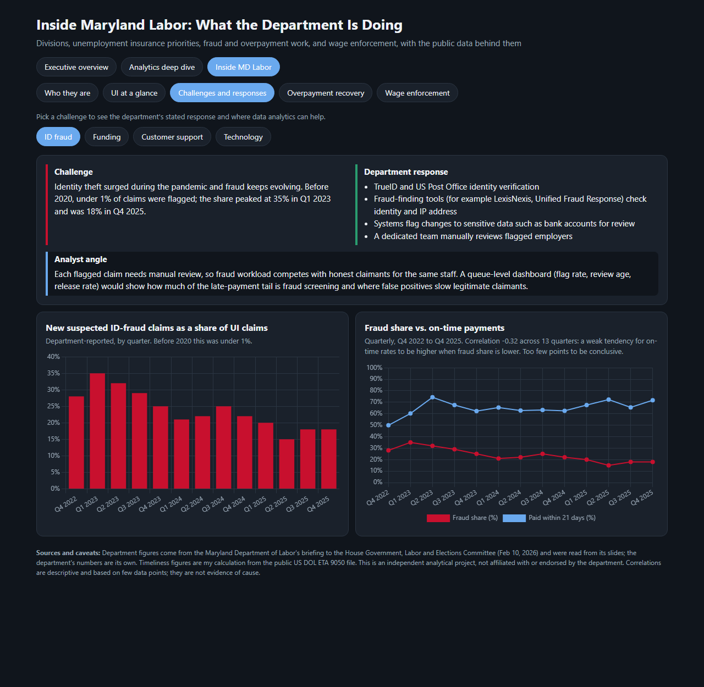

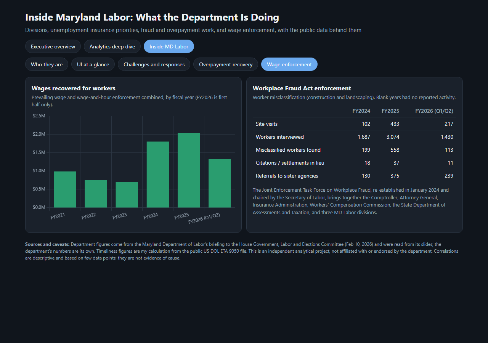

## State maps (Python and Plotly)

[`md-ui-project/maps.html`](md-ui-project/maps.html) is an interactive page with three maps (hover a state for its numbers; the base map loads from Plotly's CDN, so open it online). Built with Python and Plotly by `md-ui-project/build_maps.py`; the data is in `data/state_map_data.csv`.

**1. Where does Maryland stand?** On-time rate by state, last 12 months. Maryland is 72.5%, 48th of 53; 26 of 51 states (50 states plus DC) meet the 87% standard.

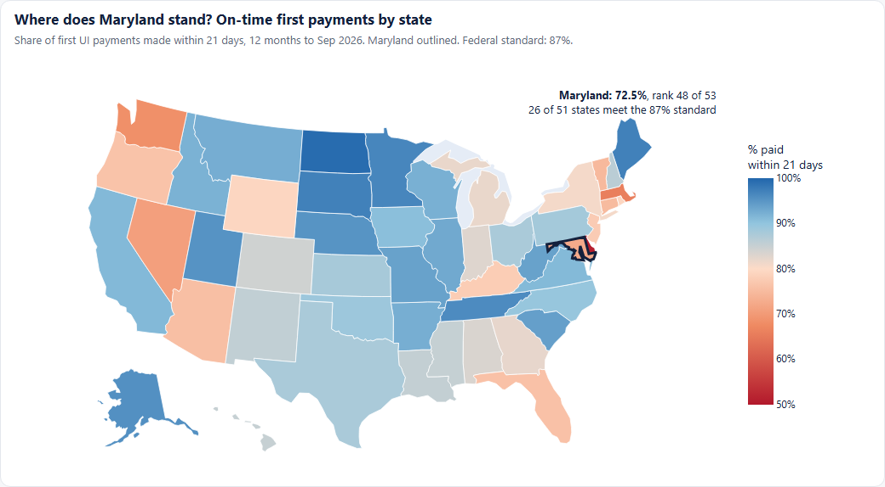

**2. Who has recovered?** Change versus 2019. Only 13 of 51 states are within 2 points of their 2019 rate. Maryland is down 19.2 points, the fifth-largest drop after Delaware (-39.7), Washington (-23.2), Massachusetts (-21.0) and Nevada (-20.8). North Carolina improved the most (+21.9).

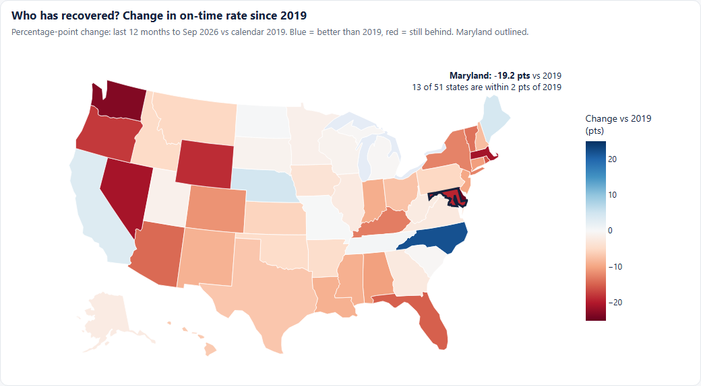

**3. Maryland and its neighbors.** A regional zoom: Maryland sits between Virginia, West Virginia and Pennsylvania (all 88% to 94%) and Delaware (50.9%).

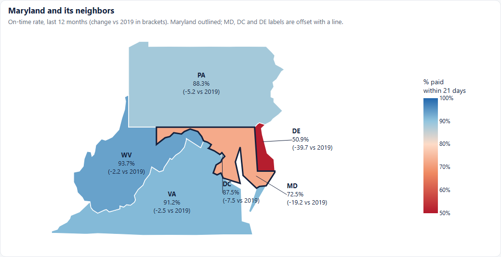

## Power BI version

[`powerbi/MD-UI-Timeliness.pbip`](powerbi/MD-UI-Timeliness.pbip) is a Power BI Project (works in free Power BI Desktop) with the same analysis as the HTML dashboards: a semantic model (9 tables loaded from `md-ui-project/data`, DAX measures such as `On-Time % 12M`, `Payments Short Of 87%` and `Maryland Rank`) and a three-page report.

| Page | What it shows |
|---|---|
| Executive overview | KPI cards, on-time trend vs the 87% standard, delay distribution, 53-jurisdiction ranking with Maryland highlighted |
| Analytics deep dive | Maryland vs neighbors and national pool, 13-week claims forecast, late payments per month, weekly claims |
| Inside MD Labor | Annual Maryland vs US, fraud share vs on-time rate, claims per quarter, wages recovered |

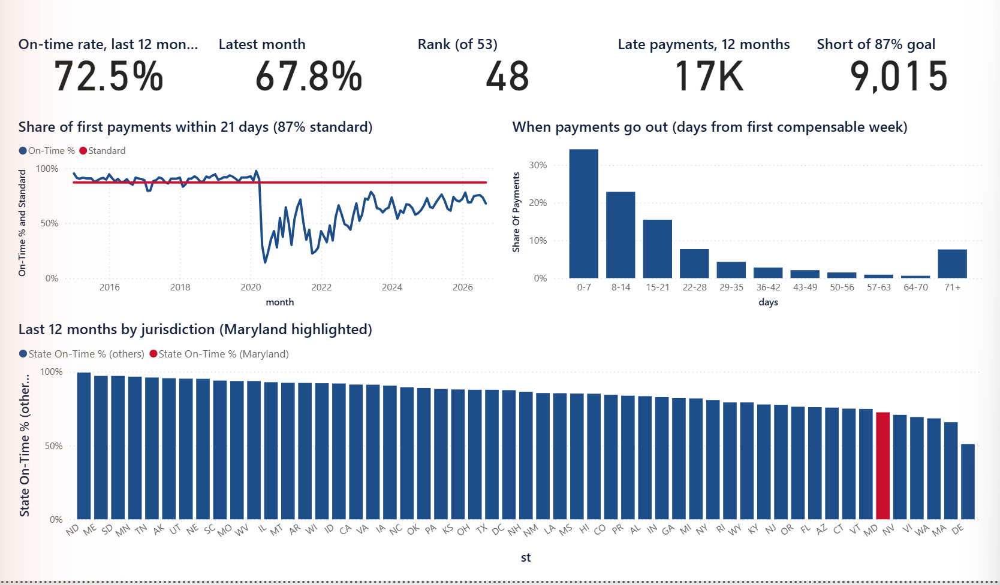

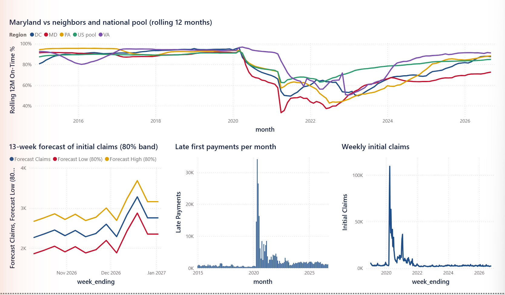

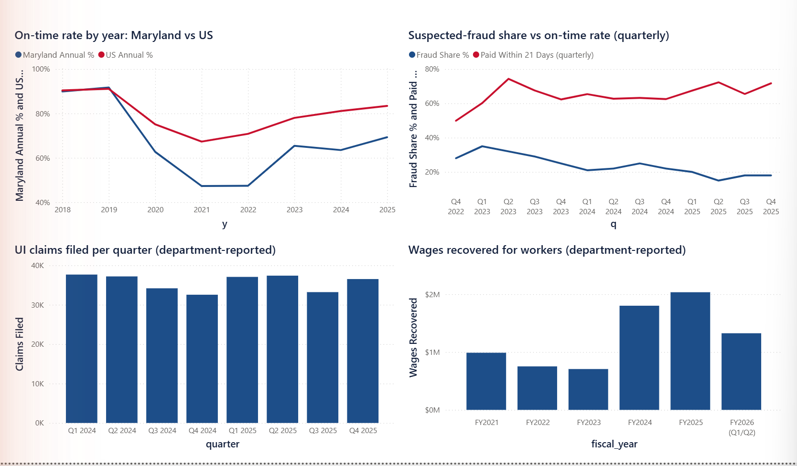

A ready-to-open [`MD-UI-Timeliness.pbix`](powerbi/MD-UI-Timeliness.pbix) (data embedded, no refresh needed) is also included.

**To open the PBIP project:**
1. Open `powerbi/MD-UI-Timeliness.pbip` in Power BI Desktop.
2. If the data folder is in a different place on your machine: Home, Transform data, Edit parameters, and set `DataFolder` to the full path of `md-ui-project\data\` (with the trailing backslash).
3. Click **Refresh now** on the yellow banner. Data is not stored in the project, so it loads on first open.

The project is generated from the CSVs by `powerbi/build_powerbi.py` (re-run it after changing the data). The interactive elements of the HTML "Inside MD Labor" page (division explorer, challenge/response tabs, overpayment timeline) are HTML-only.

## Recovery trajectory

A linear trend fitted to the rolling 12-month rate since January 2023 shows how long Maryland would take to reach 87% at its current pace.

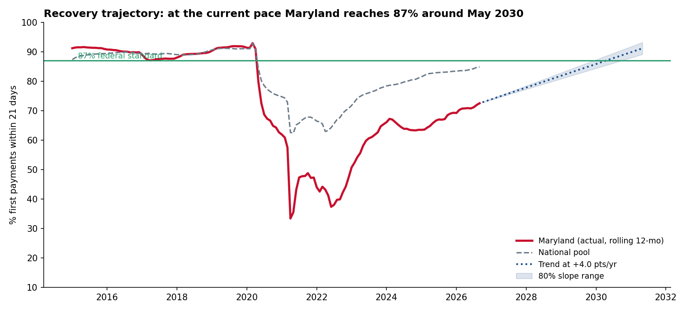

The shaded range comes from the slope's standard error. Rolling windows overlap, so it understates the real uncertainty, and part of the rise since 2023 is recovery from the 2022 trough. Treat the date as indicative, not a forecast.

## Project structure

```
md-ui-project/
  download_raw.py                  # fetch the two public DOL files into raw/
  build_data.py                    # clean datasets from ETA 9050 + ETA 539
  build_analytics.py               # peers, heatmap, workload, claims forecast
  build_trajectory.py              # recovery-trajectory analysis + chart
  build_department.py              # department-reported figures + fraud-vs-timeliness
  build_maps.py                    # state maps (Plotly) -> maps.html
  build_dashboard.py               # builds dashboard.html
  build_analytics_dashboard.py     # builds analytics_dashboard.html
  build_department_page.py         # builds department.html
  data/                            # clean CSVs (load straight into Power BI)
powerbi/
  MD-UI-Timeliness.pbip            # Power BI Project (open in Power BI Desktop)
  MD-UI-Timeliness.SemanticModel/  # tables, DAX measures (TMDL)
  MD-UI-Timeliness.Report/         # 3-page report definition (PBIR)
  build_powerbi.py                 # regenerates the project from the CSVs
docs/                              # Q&A and README images
```

## Run it

Requires Python 3.9+ with `pandas`, `numpy` and `matplotlib`.

```bash
python md-ui-project/download_raw.py
python md-ui-project/build_data.py
python md-ui-project/build_analytics.py
python md-ui-project/build_trajectory.py
python md-ui-project/build_department.py
python md-ui-project/build_maps.py
python md-ui-project/build_dashboard.py
python md-ui-project/build_analytics_dashboard.py
python md-ui-project/build_department_page.py
```

The CSVs in `md-ui-project/data/` can be loaded directly into Power BI Desktop (free) for further visuals.

## Data and method

- **Sources:** US Department of Labor, Employment and Training Administration, public files [ETA 9050 First Payments Time Lapse](https://catalog.data.gov/dataset/first-payments-time-lapse-eta-9050) (monthly) and [ETA 539 Weekly Claims](https://catalog.data.gov/dataset/unemployment-insurance-weekly-claims-extended-benefits-trigger-data-eta-539), both from [oui.doleta.gov](https://oui.doleta.gov/unemploy/DataDownloads.asp). Department figures on the third dashboard come from the [Maryland Department of Labor briefing, Feb 10, 2026](https://mgaleg.maryland.gov/meeting_material/2026/gvc%20-%20134152049604952590%20-%20MD%20Labor%20GLE%20Committee%20Briefing%202.9.26%20FINAL.pdf), read from its slides.
- **Timeliness** = first payments made within 21 days of the first compensable week divided by all first payments (intrastate and interstate, all programs).
- **Column layout of ETA 9050:** the file ships without a column dictionary. It has 24 groups of 4 columns (Total, UI, UCFE, UCX), alternating intrastate and interstate. The first pair is the total of all first payments; the next eleven pairs are 7-day lapse bands (0-7, 8-14, ... 64-70, over 70). I checked this two ways: the bands sum to the total, and my annual rates match the department's published chart (Maryland 2025: 69.3%; US 2025: 83.4%) and the reported June 2020 low of 14.1%.
- **Backdating caveat:** the Maryland Department of Labor has said the federal metric counts from the claim's effective date, so backdated claims can look late even when paid promptly. This dataset cannot separate that effect from agency delay. Claim-level timestamps would.
- **Forecast:** average weekly pattern since mid-2022 scaled to the last 8 weeks' level, with an 80% band from the residual spread and a 13-week backtest. A simple illustrative model.
- Correlations are descriptive, not causal.
- This is an independent analytical project, not affiliated with or endorsed by the Maryland Department of Labor.

## Questions and answers

[`docs/QA.md`](docs/QA.md) has short answers to the questions this analysis raises: why Maryland is low, whether it is a volume problem, how the numbers were checked, the backdating caveat, and what to do first.

## Possible next steps

- Claim-level timestamps (filed, identity verified, adjudicated, approved, paid) and issue codes, to split agency-caused from claimant-caused delay and run process mining.
- Regional or local-office breakdowns.
- A Power BI version of the dashboards on the same CSVs.
